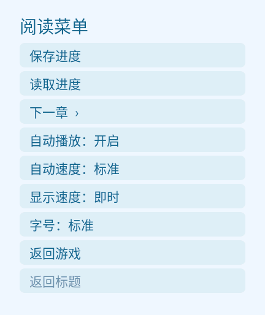

# 《ATRI》· REDMI Watch 5

作者：xuanyide。资源分析、转换工具和工程实现由 Codex 完成。

当前版本：0.1.6轻量版，目标设备REDMI Watch 5，安装包 **10,318,497字节（约10.32MB）**。新增菜单内自动播放和三档速度，剧情、立绘及图片与0.1.5相同。此前0.1.5轻量版和0.1.3完整版均已由维护者确认实机测试通过并在GitHub发布；维护者于2026-10-20确认0.1.6实机测试通过并授权发布，不声称穷举所有剧情和固件环境。

## 自动播放（0.1.6）

在阅读菜单打开“自动播放”，点击“返回游戏”继续。自动模式按约30毫秒一字显示，整句完成后等待：慢速2.6秒、标准1.5秒、快速0.8秒；超过60字的段落按额外字数延长等待，额外时间最多5秒。开启时已显示完整的当前句直接开始等待，后续句子逐字显示；手动显示速度的设置保持独立。

遇到选项必须由玩家选择，之后自动继续。打开菜单、存读档或滑动正文时暂停，返回正文/结束滑动后重新计时；切到后台不推进。手动点击未完成的文字先补全整句，再重新等待。点击“上一句”、返回标题、剧情结束或报错会关闭自动播放。每次启动默认关闭，只保存速度档位；读写30个旧存档的格式和键不变。

## 轻量版图像与历史修订

轻量版删除334个其他角色立绘资源及5,654处显示引用，保留418个亚托莉姿态/表情组合。亚托莉从原始中间图单次缩小至最多216px高、使用最多192色。0.1.5按最终图片宽高比调整显示框，从286px增大至310px（约8.4%），头部位置保持，下沿延伸到对白区域后方，由不透明对白底图遮住下方24px，避免裁剪边缘悬空。单人场景居中，多亚托莉图层保持各自水平中心。图片文件与0.1.4逐字节相同，未再次压缩，也未增加图片解码内存。469个背景与CG资源、31组71个CG差分、标题、圆形图标及字体与0.1.3逐文件字节一致，**CG没有进一步降低画质**。原游戏图中的其他人物仍保留，不把CG误当作立绘删除。

0.1.3的圆形应用图标直接裁剪自原作含亚托莉的通关后标题背景，以亚托莉的脸和上身为中心，保留海天背景，192×192、四角透明。使用原图像素裁剪、缩小及圆形蒙版，无重绘。标题画面、剧情、字体、CG、立绘和存档代码与实机通过的0.1.2逐文件字节一致。

0.1.2将字体从1,234,652字节降到655,856字节，移除横排对白不用的竖排、替代字形及相关排版表。全部2,779个字符保留，并逐字核对轮廓和横向字宽与0.1.1一致。包名、证书、剧情代码、文本、图片、分支和存档键保持不变，不降低立绘或CG画质。该变更降低安装解包及字体资源的负担；没有实机安装器日志，不能断言0.1.1失败由某个已知大小限制导致。

672 个剧本／配置文件和 3973 个图片资源通过原包 Adler-32 校验。34 个剧本文件转换为 83 个场景节点、12,172 条中文文本，手表每次仅读取一个小块剧情。独立剧情状态机通过五条普通流程的顺序阅读／章节跳跃一致性检查，跳跃遇选项即停，保留选项条件和结局状态。真结局要求先完成好结局与坏结局。

0.1.1 修复原作过渡遮罩、多个不透明背景及CG被错误缩放叠放的问题；SCN中的换行控制改为实际换行。亚托莉立绘从原始中间图一次缩放至256px、使用256色，其他人物保持224px/160色；显示下沿仍贴合对白。标题采用通关后含亚托莉的原图、原作标志和蓝色按钮，标题按钮保持START的字号并左对齐，下半区加入海蓝渐变、细线菜单容器，右下角按要求保持空白。菜单、对白、存档、章节和CG界面统一为浅色海蓝主题；对白区使用较暗的灰蓝渐变降低亮白感。标题不提供章节预览，最后一个按钮为原作EXIT，点击退出应用。TRUE END在满足原作好、坏结局解锁条件后，返回标题时才显示于START上方。包名、剧情节点、句号下标、分支和30栏位键不变，支持读取0.1.0存档。

## 下载与预览

[下载 v0.1.6 自动播放轻量版（约10.32MB）](https://github.com/xuanyide01/atri-rw5/releases/tag/v0.1.6) · [v0.1.5轻量版](https://github.com/xuanyide01/atri-rw5/releases/tag/v0.1.5) · [v0.1.3完整立绘版（约14.43MB）](https://github.com/xuanyide01/atri-rw5/releases/tag/v0.1.3)。以上版本均有维护者实机通过反馈，当前main源码为0.1.6。

手机安装使用 `.bin`，开发工具使用内容相同的 `.rpk`，无需同时安装两份。

  

截图来自标注版本的模拟器；实机测试结果来自维护者反馈。

## 功能

- 432×514界面，上方完整背景／CG与亚托莉透明立绘，下方对白。其他角色以台词和原CG呈现，不再显示独立立绘。亚托莉保留头部与上身，下沿贴合对白区域。
- 点击文本框、画面或“下一句”推进；长对白可上下滑动，支持标准／大字号、即时／逐字显示。菜单提供自动播放及慢速／标准／快速三档，选项由玩家决定后继续。
- 30 个独立存档栏位，保存与读取均自行选择栏位，覆盖已有进度前确认。
- 菜单内的“下一章”保留剧情状态并停在选项；标题不提供章节预览，正常阅读从START开始，满足解锁条件后可进入TRUE END。
- 31 组、71 张可用静态 CG。原作同场景差分放在同一组，点图切换。原配置中的 ev017b 没有对应原资源，因此该组只收录存在的 ev017a。
- 从通关后标题背景裁剪的圆形透明应用图标，以亚托莉为焦点。应用名称为《ATRI》，标题的EXIT使用标准应用退出接口。

为控制包体和运行内存，本版不含语音、BGM、视频及动态粒子演出；原作镜头运动改为静态全图。剧情文本、三处选择和结局条件来自原作，保留正确分支关系。Windows 原资源保持只读。

## 安装与使用

1. 使用“表盘自定义工具”选择随附 `.bin`，传输到 REDMI Watch 5；`.rpk` 为同一安装包的开发工具扩展名，无需同时安装两份。
2. 蓝牙传输完成后还需等待设备完成解包与安装，图标出现后再打开。不要立即重复传输。
3. 正常攻略请从 START（开始游戏）进入。好结局与坏结局都完成后，标题的 TRUE END（真结局）解锁。首次出现的“捡起鞋子”可能置灰，这是原作前置选项未满足条件时的行为。
4. 轻量版沿用原包名、分支与存档键，支持旧版进度。更新时优先保留应用数据；卸载重装可能清除存档。[0.1.5轻量版](https://github.com/xuanyide01/atri-rw5/releases/tag/v0.1.5)和[0.1.3完整版](https://github.com/xuanyide01/atri-rw5/releases/tag/v0.1.3)保留原实机测试记录；维护者另确认0.1.6实机测试通过。

## 异常处理

- 运行中退回桌面：重新打开并读取最近的存档；若重复发生，记录章节名称、对白和操作步骤，暂时关闭逐字显示后再试。
- 无法退出或界面失去响应：按设备说明正常重启，再打开应用。卸载可能删除应用存档，优先尝试重启。
- 传输后迟迟不出现图标：等待安装完成，再正常重启检查。若只有《ATRI》失败、其他应用仍可安装，记录安装工具版本与传输完成后的表现，反馈本版安装结果；不要连续重复传输同一个失败包。

## 构建与验证

0.1.6通过实际页面方法的确定性计时测试：三档等待、逐字后计时、手动补全、选项暂停并恢复、菜单/存读档/后台暂停、滑动处理，以及回看/结束/错误/销毁取消计时。独立差异检查证明1,212个common条目、12,172条文本及887个背景/CG/立绘文件与0.1.5逐字节相同，字体和存档/分支引擎不变。准确新版在官方Vela模拟器验证旧存档读取、自动推进、三档切换、菜单及存读档暂停、真实选项等待/手选后继续、回看关闭、退出重开默认关闭且保留速度档位；对白滚动和大字号另做回归。见 `reports/auto-reader-unit.json`、`reports/auto-reader-revision.json` 与随包检查报告。没有实测0.1.6手表峰值内存或帧率，维护者另确认0.1.6实机测试通过并授权公开发布。

0.1.5逐条核对全部5,065处立绘几何与418张图片下沿：保持头部位置，每个对白边界都有实体像素。准确新版在官方Vela模拟器通过全新安装、冷启动、旧存档恢复、CG差分、点击推进，并通过真实UI到达正面、宽幅、背面三种姿态，核对截图像素和对白遮挡。图片和页面脚本与0.1.4字节相同，未再增加图片解码负担。长对白滚动、大字号、五处CG和全路线逻辑沿用0.1.4记录并保留其原摘要；未重新读取所有30栏位，维护者另确认0.1.5实机测试通过；不声称穷举全部剧情和固件环境。报告见 `reports/portrait-alignment-audit.json` 和随包检查报告。

兼容编译器采用aiot-toolkit 1.1.0，可通过 `WATCH_COMPAT_TOOLKIT` 指定已安装目录。`tools/build.cjs`保留转换后图片原始字节，阻止编译器再次有损压缩，生成watch专用manifest并使用已验证的r1尾部封装。轻量版构建上限为10,500,000字节，以符合“约10MB”的目标。

```text
npm ci --prefix tools/compat-toolkit
node tools/build.cjs
python tools/audit-package.py
node tools/test-story-engine.cjs
```

锁文件保留本次使用的依赖版本。模拟器另外使用官方 aiot-toolkit 2.0.5 所带的 `@aiot-toolkit/emulator`，通过 `NODE_PATH`、`WATCH_SDK_HOME` 和 `STARRY_EMULATOR_HOME` 指定已安装的工具、SDK与专用设备目录。`tools/setup-emulator.cjs` 创建 432×514、128MB RAM 的官方 Vela Watch 5 虚拟设备；这并非红米手表实际固件的完整复制。开发过程中替换安装包后应冷启动模拟器，避免调试服务热重装冲突。

仓库中的预转换 `src/`可以直接构建。完整原资源恢复使用 `tools/extract-atri.ps1`、FreeMote、PBD/TLG工具；中间文件位于本地 `atri-probe`。全角色资源转换顺序为 `compose-portraits.py` → `prepare-watch-assets.py`；`make-atri-only.py`再依据已验证0.1.3包及原始中间立绘生成本轻量版，不能仅有公开源码就宣称重新进行了原资源提取或逐字原文校对。`assemble-ui.py`生成页面，`build-font.py`生成字体；图片压缩实验目录不在安装包或源码ZIP中。

自编代码采用 MIT；原游戏剧情、美术、图标和截图归原作权利人，**不在MIT代码许可范围内**；字体按SIL OFL 1.1。README与代码许可不授予原作素材额外使用或再分发权利。

完整检查点见 [开发与验证记录](docs/DEVELOPMENT.md)，源资源统计见 [source-inventory.json](reports/source-inventory.json)。

## 原作与致谢

原作：[《ATRI -My Dear Moments-》官网](https://atri-mdm.com/)。请支持原作。

参考社区作品的呈现形式与设备封装，由 @liuyuze61 发布的两部作品：

- [《ATRI》1.5.1](https://api.bandbbs.cn/wftools/bandbbs.html?code=A&state=1820673)。
- [《星空列车与白的旅行》1.0.0](https://api.bandbbs.cn/wftools/bandbbs.html?code=A&state=1841662)。

本项目重新转换维护者提供的Steam资源，加入角色立绘、完整主CG呈现、同场景差分鉴赏、30存档和保留选项的安全跳跃。开发由Codex完成，需求、审查与实机验证由维护者xuanyide负责。

详见[第三方说明](licenses/THIRD_PARTY_NOTICES.md)。


参考：[@liuyuze61 的《ATRI》移植](https://github.com/liuyuze61/ATRI-miband)、[GARbro-Mod](https://github.com/nanami5270/GARbro-Mod)、[GARbro](https://github.com/morkt/GARbro)、[FreeMote](https://github.com/UlyssesWu/FreeMote)及 [xp3-brute 的 PBD 格式实现](https://github.com/xmoezzz/xp3-brute)。感谢[表盘自定义工具及相关团队](https://www.bandbbs.cn/)提供安装工具。各依赖按各自许可证使用。

验证记录分开保留：完整30存档、5条普通路线和真结局、5处CG像素核对来自原生测试基线，保留其原包摘要；0.1.2另做准确包的全新安装、冷启动、分页存档保存读取、长对白滚动与大字号检查，并由用户报告实机通过。0.1.3完成换图标的打包校验与差异检查，维护者另确认实机测试通过；没有重跑全部剧情或穷举所有固件。字体全部映射字形轮廓和字宽与旧版一致，不把旧测试报告冒充本版重新跑过的结果。此前模拟器退出后约0.5秒立即重开曾触发SDK异常，同包冷启动及等待清理后重开通过；尚未确认实机存在同一问题。
